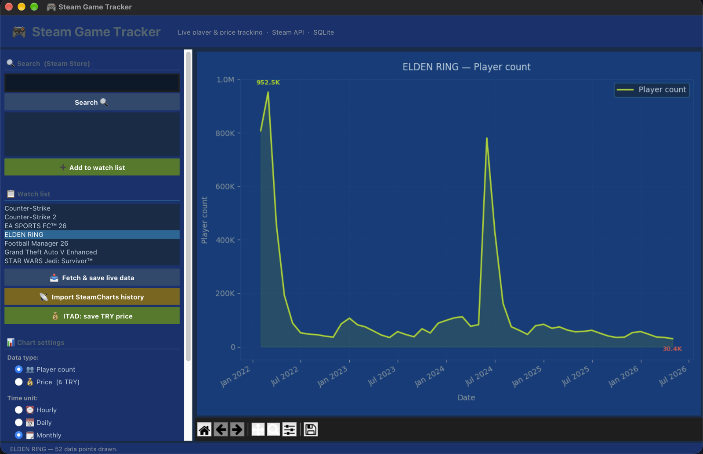

# Steam Game Tracker

A desktop app that tracks **live player counts** and **price history** for Steam games.
It pulls data from the Steam Store API, SteamCharts and IsThereAnyDeal, stores it in SQLite and draws charts with Matplotlib.

<p align="center">
  
</p>

## Features

- Search the Steam store and add games to a watch list
- Save the current player count and price with one click
- Import monthly player history from SteamCharts
- Save the current price in Turkish lira and the all-time lows from IsThereAnyDeal
- Chart player counts or prices **by hour, day or month** for any date range (with 7 / 30 / 90-day shortcuts); the highest and lowest points are labelled
- Convert Steam's USD prices to TRY with a live exchange rate (Frankfurter API)

In my own use, the database grew to about **5,900 player-count** and **480 price** records.

## Architecture

```
gui.py          ← Tkinter UI: search, watch list, chart settings, embedded Matplotlib chart
api.py          ← every external call: Steam, SteamCharts, IsThereAnyDeal, exchange rate
database.py     ← SQLite layer: tables, inserts, grouped queries (one `DB` class)
```

The UI only talks to the two lower layers, and the API and database layers don't know about each other, so each can be changed or tested on its own.

### Keeping the UI responsive

Every network call runs on a background thread (`threading.Thread`, `daemon=True`), so the window never freezes while data is loading. Tkinter can only be updated from its main thread, so each worker hands its result back with `self.after(0, ...)` instead of touching widgets directly.

### Database

`steam.db` is created on first run.

```sql
games          -- tracked games (appid, name, developer, is_free, ...)
player_counts  -- player-count snapshots (appid, count, timestamp)
price_history  -- prices (appid, TRY price, original price, discount %)
```

Charts are built with SQL `GROUP BY` on the timestamp, so switching between hourly, daily and monthly views is one query, not a loop in Python.

### Details I had to handle

- The Steam API returns prices in cents (`4999` → `49.99`), so every price is divided by 100.
- Steam Türkiye now lists prices in US dollars, so live prices are converted to lira before they are saved.
- SteamCharts timestamps come in milliseconds; values above `1e10` are converted to seconds.
- In the IsThereAnyDeal API, Steam is shop ID `61`.
- Free games have no price data, so price actions are skipped for them with a message instead of an error.
- The ITAD API key is read from an environment variable, so it never ends up in the code or the repository.

## Getting started

Requires Python 3.9+.

```bash
python -m venv venv
source venv/bin/activate        # Windows: venv\Scripts\activate
pip install -r requirements.txt
```

Price features need a free [IsThereAnyDeal API key](https://isthereanydeal.com/apps/my/):

```bash
export ITAD_API_KEY=your_key_here   # Windows: set ITAD_API_KEY=your_key_here
python gui.py
```

## How to use

1. Type a game name (e.g. `Elden Ring`) in **Search**, pick it from the results and click **Add to watch list**.
2. Select a game in the watch list and collect data:
   - **Fetch & save live data**: current player count and price from Steam
   - **Import SteamCharts history**: monthly player history (replaces older imported records)
   - **ITAD: save TRY price**: current price in lira and historical lows
3. Under **Chart settings**, choose the data type (players or price), the time unit (hourly / daily / monthly) and a date range, then click **Draw chart**.

## Tech

Python · Tkinter · Matplotlib · SQLite · Steam Store API · SteamCharts · IsThereAnyDeal API · Frankfurter API

